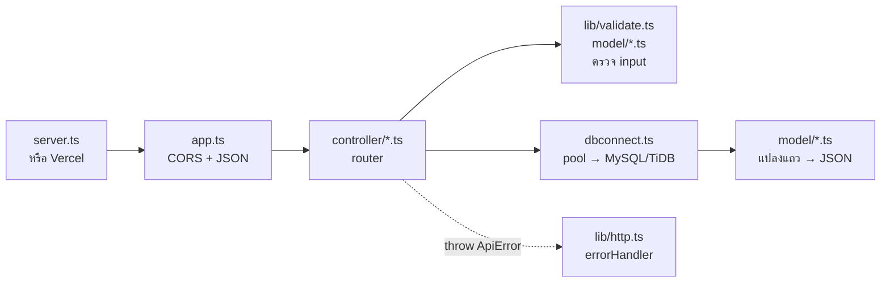

# การทำงานของแต่ละไฟล์

เอกสารนี้อธิบายว่าแต่ละไฟล์ใน backend ทำหน้าที่อะไร ทำงานอย่างไร และเชื่อมกับไฟล์อื่นตรงไหน
วิธีติดตั้งและ deploy ดูใน [README.md](../README.md) ส่วนสัญญาของแต่ละ endpoint ดู [API.md](https://github.com/SEA-S-SKY/project_Adweb/blob/master/API.md) ใน repo frontend

## ภาพรวม: request หนึ่งครั้งวิ่งผ่านไฟล์ไหนบ้าง

ตัวอย่าง `POST /api/customers`

1. `server.ts` (ในเครื่อง) หรือ Vercel รับ request แล้วส่งให้ `app` ใน `app.ts`
2. `app.ts` ตรวจ CORS แล้ว `express.json()` แปลง body เป็น object
3. `/api/customers` ถูกส่งต่อให้ router ใน `controller/customers.ts`
4. `parseCustomerInput()` ใน `model/customer.ts` ตรวจ body ถ้าผิดจะ throw `ApiError`
5. ถ้าผ่าน controller จะ `INSERT` ผ่าน `conn` จาก `dbconnect.ts` แล้วอ่านแถวที่เพิ่งเพิ่มกลับมา
6. `toCustomer()` แปลงแถว (`first_name`) เป็นรูปแบบ API (`firstName`) แล้วตอบ `201`
7. ถ้ามี error ที่ไหนก็ตาม Express 5 ส่งไปที่ `errorHandler` ใน `lib/http.ts` ให้เอง ซึ่งตอบเป็นรูปแบบ `{ error: { code, message, details } }`

---

## ไฟล์ระดับบนสุด

### `server.ts` — เปิดพอร์ตตอนรันในเครื่อง

- `import "dotenv/config"` โหลดค่าจาก `.env` เข้า `process.env` **ก่อน** import ไฟล์อื่น (เพราะ `dbconnect.ts` อ่าน env ทันทีที่ถูก import)
- สร้าง HTTP server จาก `app` แล้ว listen ที่ `PORT` (ค่าเริ่มต้น 3000)
- ใช้กับ `npm run dev` และ `npm start` เท่านั้น **บน Vercel ไม่ได้รันไฟล์นี้** และค่า env มาจากหน้า Environment Variables ของ Vercel แทน `.env`

### `app.ts` — ตัวแอป Express

ลำดับ middleware มีผล อ่านจากบนลงล่าง

| ลำดับ | ทำอะไร |
|---|---|
| `cors(...)` | อ่าน `CORS_ORIGINS` (คั่นด้วยจุลภาค) ถ้ามี `*` อยู่ในรายการจะอนุญาตทุก origin ไม่ใส่เลยจะใช้ `http://localhost:4200` (Angular dev server) |
| `express.json()` | แปลง body ที่เป็น JSON เป็น `req.body` ถ้า JSON พังจะโยน error ชนิด `entity.parse.failed` ไปที่ `errorHandler` |
| `GET /` | ตอบสถานะ `ok` ไว้เช็กว่า server ยังทำงาน |
| `/api/config`, `/api/customers`, `/api/orders` | ผูก router จาก `controller/` |
| `notFoundHandler` | ไม่ตรงเส้นไหนเลย → `404 NOT_FOUND` |
| `errorHandler` | ต้องอยู่ท้ายสุด รับ error ทุกตัวที่ถูก throw |

`export default app` มีไว้ให้ Vercel ใช้เป็น serverless function ส่วน `export const app` ใช้ใน `server.ts`

### `config.ts` — ค่าคงที่ทั้งระบบ

ตัวเลขทุกตัวที่เป็นกติกาธุรกิจอยู่ที่นี่ที่เดียว ไฟล์อื่นต้อง import จากที่นี่ ห้ามเขียนตัวเลขตรง ๆ

| กลุ่ม | ใช้ที่ไหน |
|---|---|
| `shop` (ชื่อ, พิกัดร้าน) | คำนวณ `distanceFromShopKm` และรัศมีให้บริการใน `model/customer.ts` |
| `pricing` | ยังไม่มีใครใช้ใน backend (รอ `/api/plans`) ส่งให้ frontend ผ่าน `/api/config` |
| `delivery` | `maxBoxesPerOrder` ใช้ตรวจจำนวนกล่อง, `serviceRadiusKm` ใช้ตรวจพิกัดลูกค้า ที่เหลือรอใช้ตอนจัดเส้นทาง |
| `simulate` | จำนวนออเดอร์สุ่มขั้นต่ำ/สูงสุดของ `POST /api/orders/simulate` |
| `nearby` | รัศมีค่าเริ่มต้นของ `/nearby` (ลูกค้า 1 กม., ออเดอร์ 2 กม.) และรัศมีสูงสุดที่ยอมให้ค้น (50 กม.) |
| `riderColors` | สีประจำไรเดอร์แต่ละคน ส่งให้ frontend |

ค่าที่มี ⚠️ คือยังรอทีมหรืออาจารย์ยืนยัน

### `dbconnect.ts` — เชื่อมต่อฐานข้อมูล

- **`dbOptions()`** สร้างค่าเชื่อมต่อจาก env (`DB_HOST`, `DB_PORT`, `DB_USER`, `DB_PASSWORD`, `DB_NAME`) แยกเป็นฟังก์ชันเพื่อให้ `scripts/init-db.ts` ใช้ค่าชุดเดียวกันได้
  - `dateStrings: true` ให้ `DATE`/`DATETIME` กลับมาเป็น string เช่น `"2026-09-18"` ไม่ถูกแปลงเป็น `Date` ของ JS (ซึ่งจะเลื่อนวันตาม timezone)
  - `decimalNumbers: true` ให้ `DECIMAL` (lat, lng, ผลรวม) กลับมาเป็น number แทน string
  - `charset: "utf8mb4"` รองรับภาษาไทยและอีโมจิ
- **SSL** เปิดเมื่อ `DB_SSL=true` หรือมี `DB_SSL_CA` บังคับ TLS 1.2 ขึ้นไปและตรวจใบรับรองจริง (`rejectUnauthorized: true`)
- **`trustedCa()`** รวมใบรับรองที่เชื่อถือ 3 แหล่ง: root ที่ Node มีอยู่แล้ว + ของ Let's Encrypt ใน `lib/ca.ts` + `DB_SSL_CA` ถ้าค่านั้นเป็นเนื้อหา PEM จริง (ถ้าใส่เป็น path หรือค่าอื่นจะเตือนแล้วข้ามไป เพราะถ้าส่งค่าผิดเข้าไป Node จะต่อ TiDB ไม่ได้เลย) และแปลง `\n` ที่พิมพ์เป็นตัวอักษรให้เป็นขึ้นบรรทัดใหม่
- **`conn`** คือ connection pool (สูงสุด 10 connection) ที่ทุก controller ใช้ร่วมกัน
- ทุกครั้งที่ pool เปิด connection ใหม่จะสั่ง `SET time_zone = '+07:00'` ให้ `CURRENT_TIMESTAMP` เป็นเวลาไทยเสมอ ไม่ว่าฐานข้อมูลจะอยู่ประเทศไหน

---

## `controller/` — รับ request และตอบกลับ

ทุกไฟล์ export `router` ที่ `app.ts` นำไปผูก handler เป็น `async` และ throw error ได้ตรง ๆ ไม่ต้อง try/catch

### `controller/config.ts`

`GET /api/config` ส่ง `shop`, `pricing`, `delivery`, `riderColors` จาก `config.ts` ให้ frontend (ไม่ส่ง `simulate` และ `nearby` เพราะเป็นค่าภายใน backend)

### `controller/customers.ts`

`findCustomer(id)` ใช้ซ้ำในหลายเส้น: ดึงลูกค้า 1 คนแล้วแปลงด้วย `toCustomer()` ไม่เจอคืน `null`

| เส้น | การทำงาน |
|---|---|
| `GET /` | ไม่ส่งอะไร = ทุกคน, `?search=` ค้นแบบ `LIKE %...%` ใน ชื่อ, นามสกุล, "ชื่อ นามสกุล" และเบอร์โทร, `?firstName=` / `?lastName=` ค้นแยกช่อง (ใช้คู่กันได้ เชื่อมด้วย AND) แต่ใช้ `search` ร่วมกับสองตัวนี้ไม่ได้ (400) เรียงตามชื่อ นามสกุล id |
| `GET /nearby` | ตรวจ `lat`, `lng`, `radiusKm` ด้วย `parseNearbyQuery()` คำนวณระยะด้วย `haversineSql()` ใน subquery แล้วกรอง `distance_km <= radiusKm` เรียงจากใกล้ไปไกล ผลลัพธ์มี `distanceKm` เพิ่ม **ต้องประกาศก่อน `/:id`** ไม่อย่างนั้น Express จะจับ `nearby` เป็น id |
| `GET /:id` | ไม่เจอ → 404 |
| `POST /` | ตรวจ body ด้วย `parseCustomerInput()` แล้ว INSERT ตอบ `201` พร้อมลูกค้าที่เพิ่งสร้าง |
| `PUT /:id` | ต้องส่งครบทุก field (ไม่ใช่แก้บางช่อง) ตรวจ body ก่อน แล้วค่อยเช็กว่ามีลูกค้าคนนี้ |
| `DELETE /:id` | ถ้าลูกค้ามีออเดอร์อยู่ (สถานะใดก็ได้) ตอบ `409 CUSTOMER_HAS_ORDERS` เพื่อเก็บประวัติการส่ง ลบสำเร็จตอบ `204` |

### `controller/orders.ts`

ฟังก์ชันช่วยในไฟล์

- `parseStatus()` รับได้แค่ `pending` / `assigned` / `delivered` ไม่ส่ง = ไม่กรอง
- `parseQuantity()` ต้องเป็น **number** จำนวนเต็ม 1 ถึง `maxBoxesPerOrder` (ส่ง `"2"` เป็น string จะไม่ผ่าน)
- `findOrder(id)` ดึงออเดอร์พร้อมข้อมูลลูกค้าผ่าน `ORDER_SELECT`
- `findEditableOrder(id)` แก้/ลบได้เฉพาะออเดอร์ `pending` สถานะอื่นตอบ `409 ORDER_LOCKED` (ยืนยันเส้นทางไปแล้ว)
- `inTransaction(work)` ยืม connection จาก pool เปิด transaction ถ้า `work` สำเร็จ commit ถ้า throw จะ rollback ทั้งหมด แล้วคืน connection เสมอ

| เส้น | การทำงาน |
|---|---|
| `GET /?date=&status=` | ออเดอร์ของวันนั้น (ไม่ส่ง `date` = วันนี้ตามเวลาไทย) กรองสถานะได้ |
| `GET /summary?date=` | นับจำนวนออเดอร์, รวมกล่อง, นับแยกสถานะ ใช้ `SUM(status = 'pending')` (เงื่อนไขจริง = 1) และ `COALESCE` กันค่า `NULL` ตอนไม่มีออเดอร์ |
| `GET /nearby` | เหมือนของลูกค้า แต่ไม่ส่ง `date` = ทุกวัน แทรกคอลัมน์ระยะเข้า `ORDER_SELECT` ด้วย `.replace()` ลำดับ params คือ `[lat, lat, lng, date?, status?, radiusKm]` ตามลำดับ `?` ใน SQL |
| `POST /simulate` | ดูหัวข้อถัดไป |
| `DELETE /all` | ล้างทุกอย่างใน transaction ลบตามลำดับ foreign key `job_stops → jobs → plans → orders` (ลูกค้าไม่ถูกลบ) ตอบจำนวนที่ลบ |
| `GET /:id` | ไม่เจอ → 404 |
| `POST /` | `customerId` ต้องเป็นจำนวนเต็มบวกและมีลูกค้าคนนั้นจริง (ไม่มี → 400 ไม่ใช่ 404), `quantity` ผ่าน `parseQuantity()`, `orderDate` ไม่ส่ง = วันนี้ ตอบ `201` |
| `PATCH /:id` | แก้ได้เฉพาะ `quantity` และเฉพาะออเดอร์ `pending` |
| `DELETE /:id` | ลบได้เฉพาะออเดอร์ `pending` ตอบ `204` |
| `DELETE /?date=` | ลบออเดอร์ `pending` ทั้งหมดของวันนั้น (ปุ่ม "ล้างออเดอร์ที่รอจัด") ตอบ `204` |

`/summary`, `/nearby`, `/simulate`, `/all` ต้องประกาศก่อน `/:id` ด้วยเหตุผลเดียวกับของลูกค้า

**`POST /simulate` ทำงานอย่างไร**

1. `orderDate` ไม่ส่ง = วันนี้, `replaceExisting` ไม่ส่ง = `true`, `count` ไม่ส่ง = สุ่มระหว่าง `simulate.minOrders`–`maxOrders` (20–30) ถ้าส่งต้องเป็น 1–100
2. ทั้งหมดต่อจากนี้อยู่ใน transaction เดียว
3. ถ้า `replaceExisting` ลบออเดอร์ `pending` เดิมของวันนั้นก่อน (ออเดอร์ที่ assigned แล้วไม่ถูกแตะ)
4. หาลูกค้าที่ **ยังไม่มีออเดอร์ในวันนั้น** (กติกา: ลูกค้า 1 คนมีได้ 1 ออเดอร์ต่อวัน) ถ้ามีไม่พอ `count` ตอบ 400 และ rollback
5. สับลำดับลูกค้าด้วย Fisher–Yates แล้วหยิบ `count` คนแรก สุ่มจำนวนกล่อง 1–3 ให้แต่ละคน
6. INSERT ทีเดียวทุกแถวด้วย `VALUES ?` (mysql2 แปลง array ซ้อนเป็นหลายแถวให้)
7. ดึงออเดอร์ที่เพิ่งสร้างกลับมาตอบ `201`

> กติกา "1 ออเดอร์ต่อลูกค้าต่อวัน" ตอนนี้บังคับเฉพาะใน `/simulate` ส่วน `POST /` ยังเพิ่มซ้ำได้ และฐานข้อมูลไม่มี UNIQUE key กันไว้

---

## `model/` — รูปร่างข้อมูลและตัวแปลง

แต่ละไฟล์มี interface 2 แบบ: `...Row` คือแถวจากฐานข้อมูล (snake_case) และแบบที่ส่งออก API (camelCase ตรงกับ `api.models.ts` ใน frontend)

### `model/customer.ts`

- **`toCustomer(row)`** แปลงชื่อคอลัมน์, คำนวณ `distanceFromShopKm` ด้วย `haversineKm()` ใน JS (ไม่ได้เก็บในฐานข้อมูล), แปลงเวลาเป็น ISO `+07:00` และใส่ `distanceKm` เฉพาะเมื่อแถวมาจาก `/nearby`
- **`parseCustomerInput(body)`** ตรวจ body ของ POST/PUT โดยเก็บ error ทุกช่องรวมใน `details` แล้ว throw ทีเดียว (frontend จึงแสดงผิดได้ทุกช่องพร้อมกัน)
  - `firstName`, `lastName` บังคับ ยาวไม่เกิน 50, `address` ไม่บังคับ ยาวไม่เกิน 255 ตัดช่องว่างหัวท้ายทุกช่อง และค่าว่างนับเป็นไม่ได้กรอก
  - `phone` รับ string หรือ number ลบช่องว่างและ `-` ออกแล้วต้องเป็นตัวเลข 9–10 หลัก
  - `lat`, `lng` ต้องเป็น number ในช่วงที่ถูกต้อง
  - ผ่านทั้งหมดแล้วค่อยเช็กว่าอยู่ในรัศมี `serviceRadiusKm` (3 กม.) จากร้าน ไม่อยู่ → `400 OUT_OF_SERVICE_AREA`
  - ปัดพิกัดเหลือทศนิยม 6 ตำแหน่งให้ตรงกับ `DECIMAL(9,6)`

### `model/order.ts`

- `OrderStatus` และ `ORDER_STATUSES` รายการสถานะที่ใช้ตรวจ input
- **`ORDER_SELECT`** คำสั่ง SELECT กลาง `orders JOIN customers` ทุกเส้นของออเดอร์ใช้ตัวนี้แล้วต่อ `WHERE` เอง ผลลัพธ์จึงมีข้อมูลลูกค้าแนบมาเสมอ
- **`toOrder(row)`** แปลงแถวเป็นออเดอร์ที่มี object `customer` ซ้อนอยู่ข้างใน

---

## `lib/` — ตัวช่วยที่ใช้ทั้งโปรเจกต์

### `lib/http.ts` — รูปแบบ error กลาง

- `ApiErrorCode` รายการ code ทั้งหมดตาม API.md (`NO_ORDERS`, `PLAN_ALREADY_CONFIRMED` เตรียมไว้ให้ `/api/plans`)
- `ApiError(status, code, message, details?)` throw ตัวนี้จาก controller ได้เลย
- `badRequest()` = 400 `VALIDATION_ERROR`, `notFound()` = 404 `NOT_FOUND`
- `notFoundHandler` ตอบ 404 เมื่อไม่มีเส้นที่ตรง
- `errorHandler` แยก 3 กรณี: `ApiError` → ตอบตาม status/code ของมัน, JSON พัง → 400, อย่างอื่น → log ลง console แล้วตอบ `500 INTERNAL_ERROR` (ไม่ส่งรายละเอียด error ภายในออกไป)

### `lib/validate.ts` — ตรวจค่าจาก query/params

- `queryString(v)` อ่าน query เป็น string ตัวเดียว (ถ้าส่งซ้ำ `?a=1&a=2` เอาตัวแรก) ตัดช่องว่าง ค่าว่างคืน `undefined`
- `parseId(v)` ต้องเป็นจำนวนเต็มบวก ไม่ใช่ → 400
- `todayBangkok()` วันนี้ตามเวลาไทยรูปแบบ `YYYY-MM-DD` (locale `en-CA` ให้รูปแบบนี้พอดี) ใช้แทน `new Date()` เพราะ server บน Vercel เป็นเวลา UTC
- `isValidDate(s)` เช็กทั้งรูปแบบและวันที่มีจริง (`2026-02-30` ไม่ผ่าน)
- `parseDate(v, field, fallbackToday)` ไม่ส่งค่า → วันนี้ (หรือ `undefined` ถ้า `fallbackToday = false`) มี overload ให้ TypeScript รู้ว่าค่าที่คืนเป็น `string` แน่นอนเมื่อมี fallback
- `parseNearbyQuery(query, defaultRadiusKm)` ตรวจ `lat`, `lng` (บังคับ) และ `radiusKm` (ไม่ส่งใช้ค่าเริ่มต้น ต้องไม่เกิน `nearby.maxRadiusKm`) รวม error ทุกช่องก่อน throw

### `lib/format.ts`

- `round2(n)` ปัดทศนิยม 2 ตำแหน่ง (ระยะทาง)
- `toIsoBangkok(dt)` `"2026-09-18 10:05:00"` → `"2026-09-18T10:05:00+07:00"` เวลาในฐานข้อมูลเป็นเวลาไทยอยู่แล้ว (ดู `dbconnect.ts`) จึงแค่ต่อ `+07:00` ไม่ต้องแปลง

### `lib/ca.ts` — ใบรับรอง Let's Encrypt

เก็บใบรับรอง root (ISRG X1, X2, Root YE, Root YR) และใบกลาง (YE1, YE2, YR1, YR2) แบบ PEM เป็นข้อมูลสาธารณะ ไม่ใช่ความลับ TiDB Cloud ใช้สาย YE1 → Root YE ที่ Node บางเวอร์ชันยังไม่รู้จัก บน Vercel จึงเจอ `unable to get local issuer certificate` ถ้าไม่มีไฟล์นี้ `dbconnect.ts` นำไปรวมใน `trustedCa()` **ห้ามลบ**

---

## `service/distance.ts` — คำนวณระยะทาง

- **`haversineKm(a, b)`** ระยะเส้นตรงบนผิวโลกระหว่างสองพิกัด (กม.) ใช้ใน JS เช่น `distanceFromShopKm` และตรวจรัศมีให้บริการ
- **`haversineSql(latCol, lngCol)`** สูตรเดียวกันในรูป SQL ใช้ใน `/nearby` ให้ฐานข้อมูลกรองและเรียงให้ มี `?` 3 ตัว ต้องส่ง params `[lat, lat, lng]` ของจุดศูนย์กลางตามลำดับนี้ `LEAST(1, ...)` กันค่าเกิน 1 จากการปัดเศษ ซึ่งจะทำให้ `ASIN` คืน `NULL`
  ใช้สูตรเองแทน `ST_Distance_Sphere` เพราะ TiDB ยังไม่รองรับฟังก์ชัน spatial

---

## ฐานข้อมูล

### `sql/schema.sql`

⚠️ `DROP TABLE` ทุกตารางก่อนสร้างใหม่ รันแล้วข้อมูลเดิมหายหมด

| ตาราง | หน้าที่ | จุดสำคัญ |
|---|---|---|
| `customers` | ลูกค้า | index ที่ `first_name`, `last_name` ไว้ค้นชื่อ |
| `orders` | ออเดอร์ | FK ไป `customers`, `CHECK quantity 1–3`, index `(order_date, status)` ตรงกับเงื่อนไขที่ค้นบ่อย |
| `plans` | ผลการจัดเส้นทาง (ยังไม่มี API) | `seed` ไว้สุ่มซ้ำได้, ผลทั้งหมดเก็บเป็น `result_json` |
| `jobs` | ใบงานของไรเดอร์ 1 คน (ยังไม่มี API) | `job_no` ห้ามซ้ำ, FK ไป `plans` |
| `job_stops` | จุดส่งในใบงาน (ยังไม่มี API) | ออเดอร์ 1 รายการอยู่ได้ 1 จุดส่ง, `(job_id, seq)` ห้ามซ้ำ, ลบใบงานแล้วจุดส่งหายตาม (`ON DELETE CASCADE`) |

ท้ายไฟล์ใส่ลูกค้าตัวอย่าง 30 คน (ข้อมูลสมมติ) อยู่ในรัศมี 3 กม. จากร้านทั้งหมด

### `scripts/init-db.ts` — `npm run db:init`

1. โหลด `.env` แล้วอ่าน `sql/schema.sql`
2. ใช้ `dbOptions()` ชุดเดียวกับแอป แต่เชื่อมต่อแบบ **ยังไม่เลือกฐานข้อมูล** เพื่อสร้างฐานข้อมูลได้ถ้ายังไม่มี
3. เช็กว่า `DB_NAME` มีแค่ `A-Z a-z 0-9 _` เพราะชื่อฐานข้อมูลถูกต่อเข้า SQL ตรง ๆ (ใช้ `?` กับชื่อฐานข้อมูลไม่ได้)
4. `CREATE DATABASE IF NOT EXISTS` → `USE` → รันทั้งไฟล์ทีเดียว (`multipleStatements: true`)
5. นับลูกค้าแล้วพิมพ์ผล ล้มเหลวจะจบด้วย exit code 1

---

## ไฟล์ตั้งค่า

| ไฟล์ | หน้าที่ |
|---|---|
| `package.json` | dependency (express 5, mysql2, cors, dotenv) และคำสั่ง `dev` / `build` / `start` / `db:init` |
| `tsconfig.json` | คอมไพล์เป็น CommonJS ES2022 ลง `dist/` เปิด `strict` |
| `vercel.json` | ตั้ง region `sin1` (สิงคโปร์) ให้อยู่ใกล้ TiDB ลดเวลาเชื่อมต่อ |
| `.env.example` | ตัวอย่างค่า env ทั้งแบบ MySQL ในเครื่องและ TiDB Cloud คัดลอกเป็น `.env` แล้วแก้ |
| `.gitignore` | ไม่ commit `node_modules/`, `dist/`, `.env`, `*.log` |
| `postman/project_Adweb.postman_collection.json` | request ทดสอบทุกเส้น แบ่งเป็น Config / Customers / Orders ใช้ตัวแปร `baseUrl`, `customerId`, `orderId`, `date` ฯลฯ |

---

## เพิ่ม endpoint ใหม่ (เช่น `/api/plans`)

1. สร้าง `controller/plans.ts` export `router` แล้วผูกใน `app.ts` ตรงคอมเมนต์ `/api/plans และ /api/jobs`
2. ถ้ามีเส้นแบบ `/something` และ `/:id` ให้ประกาศ `/something` ก่อน
3. ตรวจ input ด้วยฟังก์ชันใน `lib/validate.ts` และ throw `badRequest()` / `notFound()` / `ApiError` แทนการ `res.status(...)` เอง
4. ตัวเลขกติกาใหม่ใส่ใน `config.ts`
5. งานที่เขียนหลายตารางพร้อมกันให้ใช้ transaction แบบ `inTransaction()` ใน `controller/orders.ts`
6. ระยะทางใช้ `haversineKm()` / `haversineSql()` ห้ามใช้ฟังก์ชัน spatial ของ MySQL
